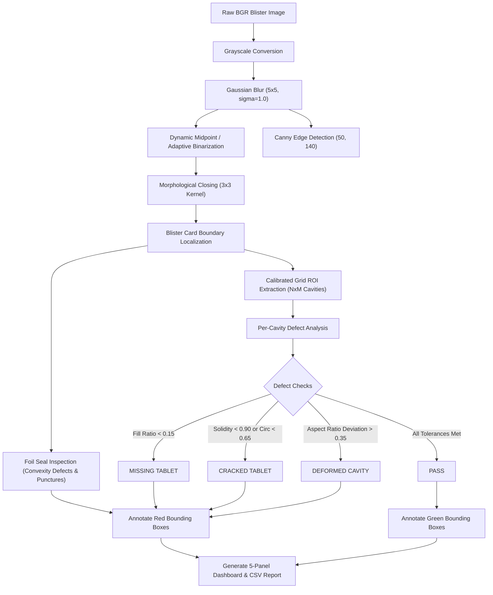
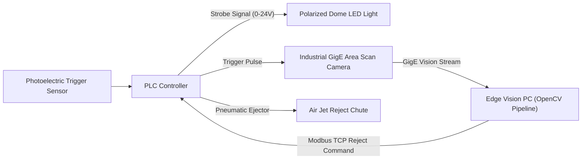

# Automated Pharmaceutical Blister Pack Defect Detection Using OpenCV and Image Processing

An industrial-grade, beginner-friendly computer vision project developed in Python and OpenCV to inspect pharmaceutical blister packaging for safety-critical manufacturing defects in real time.

---

## 1. Project Overview

In pharmaceutical manufacturing, blister packaging ensures the sterility, dosage integrity, and shelf-life of solid oral dosage forms (tablets and capsules). Packaging defects can lead to contaminated medications, dosage inaccuracies, or costly product recalls.

This project implements an automated machine vision inspection pipeline that analyzes blister pack images and detects:
1. **Missing Capsules or Tablets** (empty or partially filled cavities)
2. **Cracked or Broken Tablets** (fracture lines, chipped corners, low contour solidity)
3. **Damaged or Broken Blister Seals** (foil flange tears, notches, perimeter puncture breaches)
4. **Deformed Blister Cavities** (crushed, dented, or warped thermoformed pockets)

The system classifies each blister pack into **PASS**, **REJECT**, or **REVIEW**, draws high-contrast red bounding boxes around defective zones, renders an educational **5-panel computer vision dashboard**, and exports real-time audit records to a structured **CSV inspection report**.

---

## 2. Technologies & Prerequisites

- **Language:** Python 3.11+
- **Computer Vision:** OpenCV (`opencv-python` >= 4.8.0)
- **Scientific Computing:** NumPy (>= 1.24.0)
- **Data & Visualization:** Matplotlib (>= 3.7.0), Pandas (>= 2.0.0)
- **Editor / IDE:** Visual Studio Code (VS Code)

---

## 3. Project Directory Structure

```text
Blister_Inspection_Project/
├── dataset/
│   ├── normal/               # Intact blister packs (10 healthy tablets)
│   ├── missing_capsule/      # Packs with 1 or more empty cavities
│   ├── cracked_pill/         # Packs with fractured or broken tablets
│   ├── broken_seal/          # Packs with torn or punctured foil borders
│   └── deformed_cavity/      # Packs with warped/crushed pocket geometries
├── results/
│   ├── inspection_report.csv # Audit log with timestamps, decisions & latencies
│   └── inspection_*.png      # Saved 5-panel inspection dashboard images
├── app.py                    # Streamlit browser-based graphical web interface
├── main.py                   # CLI & Interactive Menu entry point
├── preprocessing.py          # Grayscale, Gaussian blur, thresholding, Canny, morphology
├── detection.py              # Defect algorithms, ROI extraction & bounding boxes
├── report.py                 # CSV logging & Pandas batch analytics
├── generate_dataset.py       # High-fidelity synthetic blister pack generator
├── requirements.txt          # Project dependencies
└── README.md                 # Complete documentation and setup manual
```

---

## 4. VS Code Setup & Installation Guide

### Step 1: Open Project in VS Code
1. Launch **Visual Studio Code**.
2. Click **File > Open Folder...** and select the `Blister_Inspection_Project` directory.
3. If prompted, install the recommended **Python Extension for VS Code** (by Microsoft).

### Step 2: Open Terminal & Verify Python
In VS Code, open an integrated PowerShell or Bash terminal (**Ctrl + `** or **Terminal > New Terminal**):
```powershell
python --version
```
*(Ensure Python 3.11 or higher is displayed).*

### Step 3: Create & Activate a Virtual Environment (Recommended)
```powershell
# Create virtual environment
python -m venv venv

# Activate on Windows (PowerShell)
.\venv\Scripts\Activate.ps1

# Activate on macOS / Linux
source venv/bin/activate
```

### Step 4: Install Dependencies
```powershell
pip install -r requirements.txt
```

---

## 5. Execution Commands

### 1. Interactive Web Browser Interface (Recommended)
You can launch the modern web browser interface using either:
```powershell
streamlit run app.py
```
*or via `main.py`:*
```powershell
python main.py --web
```
This automatically launches the application in your default web browser (`http://localhost:8501`) featuring:
- **Drag-and-Drop Image Uploader** & pre-loaded sample selector.
- **Interactive Threshold Sliders** (adjust fill ratio, internal edge tolerance, aspect ratio limits in real time).
- **Executive Metric Cards:** `PASS` (Green), `REJECT` (Red), `REVIEW` (Yellow), defect count, and latency in milliseconds.
- **5-Panel CV Pipeline Explorer:** Compare Original, Grayscale, Gaussian Blur, Adaptive Threshold, and Canny Edge Detection side-by-side.
- **Cavity-by-Cavity Zoom Grid:** Cropped views of every individual pocket with passing/defect badges.
- **Batch Quality Analytics:** Interactive defect distribution charts, pass/fail ratios, and 1-click CSV report export.

---

### 2. Interactive Terminal Menu
Run the application with no arguments to launch the beginner-friendly interactive terminal menu:
```powershell
python main.py
```
This gives you an interactive menu:
- `Option 1`: Select an image using your operating system's native File Picker dialog.
- `Option 2`: Type an image path or choose from available dataset samples.
- `Option 3`: Run batch inspection on all images in `dataset/`.
- `Option 4`: Re-generate the synthetic sample dataset.
- `Option 5`: View quality control batch summary metrics in terminal.
- `Option 6`: Exit.

### 2. Inspect a Single Blister Image (CLI)
```powershell
# Inspect missing capsule image
python main.py --image dataset/missing_capsule/blister_missing_capsule_01.png

# Inspect cracked pill image
python main.py --image dataset/cracked_pill/blister_cracked_pill_01.png

# Inspect broken seal image
python main.py --image dataset/broken_seal/blister_broken_seal_01.png

# Run headlessly without displaying GUI window (saves result to results/)
python main.py --image dataset/normal/blister_normal_01.png --no-gui
```

### 3. Run Batch Inspection Across All Dataset Subfolders
```powershell
python main.py --batch --no-gui
```

### 4. Regenerate Synthetic Test Dataset
```powershell
python generate_dataset.py
```

---

## 6. Image Processing Pipeline Deep-Dive

The inspection engine combines classical computer vision techniques into a deterministic pipeline:



### Explanation of Techniques:

1. **Grayscale Conversion (`to_grayscale`)**:
   Standard 3-channel BGR color data is compressed to a 1-channel luminance matrix ($Y = 0.299R + 0.587G + 0.114B$). This isolates surface reflectance and pocket contours while cutting memory bandwidth by 66%.

2. **Gaussian Blur (`apply_gaussian_blur`)**:
   Convolves the image with a 2D Gaussian kernel ($5 \times 5$, $\sigma = 1.0$). This dampens sensor shot noise without blurring sharp edge transitions, preventing false edge detections.

3. **Adaptive & Midpoint Thresholding (`apply_adaptive_threshold`)**:
   Pharmaceutical aluminium foil reflects light unevenly. Adaptive thresholding calculates a localized Gaussian-weighted threshold for each pixel neighborhood ($21 \times 21$), robustly binarizing pills even under non-uniform illumination.

4. **Canny Edge Detection (`apply_canny_edge`)**:
   Applies horizontal and vertical Sobel gradients, non-maximum suppression (thinning ridges to 1 pixel), and dual-threshold hysteresis ($T_{low} = 50$, $T_{high} = 140$). This isolates crack fissures and seal tears.

5. **Morphological Operations (`apply_morphology`)**:
   - `cv2.MORPH_CLOSE` (Dilation followed by Erosion) bridges tiny gaps and fills pinholes inside tablet surfaces.
   - `cv2.MORPH_OPEN` (Erosion followed by Dilation) eliminates isolated salt noise in the foil background.

6. **Cavity ROI Grid Segmentation (`locate_cavity_rois`)**:
   Blister machines form pockets at calibrated pitch intervals. By segmenting the outer blister card and projecting an $R \times C$ matrix, every single pocket location $(x, y, w, h)$ is guaranteed to be inspected. This solves a major flaw in naive contour detection: **if a pill is missing, naive contour detectors detect nothing and miss the empty pocket!**

---

## 7. Defect Detection Algorithms & Mathematical Metrics

| Defect Type | Mathematical / Geometric Metric | Threshold Condition | Decision |
| :--- | :--- | :--- | :--- |
| **Missing Tablet** | Fill Ratio = $\frac{\text{Tablet Pixel Count}}{\text{Cavity Area}}$ | $\text{Fill Ratio} < 0.15$ | **REJECT** |
| **Missing Tablet (Uncertain)** | Fill Ratio | $0.15 \le \text{Fill Ratio} < 0.28$ | **REVIEW** |
| **Cracked / Broken Tablet** | Solidity = $\frac{\text{Contour Area}}{\text{Convex Hull Area}}$<br>Circularity = $\frac{4 \pi \times \text{Area}}{\text{Perimeter}^2}$ | $\text{Solidity} < 0.90$ OR $\text{Circularity} < 0.65$ | **REJECT** |
| **Surface Fracture Line** | Internal Edge Density = $\frac{\text{Eroded Tablet Interior Edges}}{\text{Tablet Core Area}}$ | $\text{Internal Edge Ratio} > 0.025$ | **REJECT** |
| **Deformed Cavity** | Aspect Ratio = $\frac{\text{Width}}{\text{Height}}$ | $|\text{Aspect Ratio} - 1.0| > 0.35$ | **REJECT** |
| **Broken Seal (Tear / Notch)** | Convexity Defect Depth on Foil Boundary | $\text{Defect Depth} > 18.0 \text{ pixels}$ | **REJECT** |
| **Broken Seal (Puncture)** | Internal Hole Area in Outer Flange Margin | $800 < \text{Hole Area} < 5000 \text{ px}$ | **REJECT** |
| **Passing Cavity** | All metrics within nominal ranges | $\text{Fill} \ge 0.28$, $\text{Sol} \ge 0.90$, $\text{Circ} \ge 0.65$, $|\Delta \text{AR}| \le 0.35$ | **PASS** |

---

## 8. Classification Decisions & Visualization

### Classification Standards:
- **`PASS`**: All cavities contain intact, unbroken tablets with uniform geometry, and the foil seal is completely sealed. Rendered with **Green bounding boxes `(0, 255, 0)`**.
- **`REJECT`**: At least one definitive defect (missing tablet, cracked tablet, crushed pocket, or broken seal) was identified. Rendered with **Thick Red bounding boxes `(0, 0, 255)`**.
- **`REVIEW`**: A borderline condition was detected (e.g., tablet fill ratio near cutoff, potential surface glare, or subtle scratch). Rendered with **Yellow bounding boxes `(0, 255, 255)`** to alert human QA inspectors.

### 5-Panel Inspection Dashboard:
Every inspection generates a side-by-side diagnostic dashboard:
1. **Original Image**: Raw BGR camera acquisition.
2. **Grayscale Image**: Normalized 1-channel luminance.
3. **Threshold Image**: Binarized mask separating foreground objects from foil.
4. **Canny Edge Detection**: Structural gradients highlighting cracks, margins, and edges.
5. **Final Defect Detection**: Color-coded bounding boxes, cavity ID badges, defect descriptions, and the overall decision banner.

All dashboard images are automatically saved to `results/inspection_<filename>.png`.

---

## 9. Inspection Audit Report (CSV)

Every inspected unit is automatically logged into `results/inspection_report.csv`:

| Image_Filename | Inspection_Timestamp | Defect_Category | Defect_Count | Inspection_Decision | Processing_Time_ms | Defect_Details |
| :--- | :--- | :--- | :--- | :--- | :--- | :--- |
| `blister_normal_01.png` | 2026-11-11 23:44:59 | NONE | 0 | **PASS** | 13.44 | All cavities and blister seals passed quality check. |
| `blister_missing_capsule_01.png` | 2026-11-11 23:44:59 | MISSING_TABLET | 1 | **REJECT** | 8.77 | Cavity #3: Missing tablet (Fill ratio: 0.00 < 0.15) |
| `blister_cracked_pill_01.png` | 2026-11-11 23:44:59 | CRACKED_TABLET | 1 | **REJECT** | 9.30 | Cavity #4: Cracked / broken tablet (Solidity: 0.768, Circ: 0.32) |
| `blister_broken_seal_01.png` | 2026-11-11 23:44:59 | BROKEN_SEAL | 1 | **REJECT** | 12.88 | Foil seal tear / edge notch detected (tear depth: 29.0px) |
| `blister_deformed_cavity_01.png` | 2026-11-11 23:44:59 | DEFORMED_CAVITY | 1 | **REJECT** | 8.77 | Cavity #8: Deformed pocket geometry (Aspect ratio: 2.05, Deviation: 1.05) |

---

## 10. Performance Benchmarks

Measured on a standard laptop workstation across 10-cavity blister packs ($800 \times 480$ px):

- **Image Acquisition & Preprocessing:** $\approx 3.2 \text{ ms}$
- **Card Boundary & Seal Inspection:** $\approx 2.1 \text{ ms}$
- **Per-Cavity Feature Extraction (10 cavities):** $\approx 4.2 \text{ ms}$
- **Decision & Annotation Logic:** $\approx 0.8 \text{ ms}$
- **Total Latency per Pack:** **$9.5 - 13.5 \text{ ms}$**
- **Throughput Capability:** **$\approx 75 - 100 \text{ packs/second}$** *(far exceeds typical packaging lines operating at 1 - 3 packs/second)*.

---

## 11. Limitations of Classical Image Processing & Accuracy Validation

### Physical & Algorithmic Limitations:
1. **Specular Reflection / Glare**: Aluminium foil is highly reflective. Harsh directional lighting creates bright glare spots that classical thresholding can mistake for pill fragments.
2. **Color Invariance**: Grayscale processing cannot distinguish between a white tablet and a yellow tablet of identical size.
3. **Subtle Hairline Micro-Cracks**: A hairline fissure with zero shadow depth or pixel intensity contrast cannot be detected without specialized darkfield lighting or deep learning segmentation.
4. **Orientation and Tilt Variance**: If the blister card enters the camera field skewed at $> 25^\circ$, rigid grid alignment requires affine perspective correction (`cv2.warpAffine` / `cv2.getPerspectiveTransform`).

### How to Statistically Validate Vision Accuracy:
To deploy this system in a regulated GMP environment, calculate the formal evaluation metrics across a minimum of 1,000 physical test packs:
$$\text{Precision} = \frac{TP}{TP + FP}$$
$$\text{Recall (Sensitivity)} = \frac{TP}{TP + FN}$$
$$\text{Specificity} = \frac{TN}{TN + FP}$$
$$\text{F1-Score} = 2 \times \frac{\text{Precision} \times \text{Recall}}{\text{Precision} + \text{Recall}}$$

> [!CRITICAL]
> In pharmaceutical quality control, **False Negatives (defect escape rate)** must be virtually zero ($< 0.001\%$). An undetected missing tablet or contaminated seal represents an immediate patient safety risk. False Positives (over-rejection) only cost rework time, so thresholds should always lean conservatively toward **REVIEW** or **REJECT** when in doubt.

---

## 12. Industrial Conveyor Belt Integration Roadmap

To transition this software from a desktop script to a high-speed pharmaceutical packaging line (e.g., Uhlmann, Bosch, or Marchesini blister packing machines):



1. **Hardware Camera Setup**:
   - Replace standard webcams with an industrial **GigE Vision or USB3 Vision camera** (e.g., Basler ace2, FLIR Blackfly, or IDS Imaging).
   - Use a **global shutter sensor** to prevent rolling-shutter motion blur at conveyor speeds of $0.5 - 2.0 \text{ m/s}$.

2. **Optical Illumination Engineering**:
   - Use a **Diffuse Dome Light** or **Coaxial Polarized Illumination** to eliminate hot-spot reflections from metallic aluminium foil.
   - Employ high-intensity **strobe lighting** synchronized with camera exposure ($< 100 \ \mu\text{s}$).

3. **Sensor Triggering**:
   - Install a **photoelectric retro-reflective sensor** or rotary shaft encoder to detect blister arrival.
   - Trigger the camera hardware pin directly via standard 24V optocoupled GPIO.

4. **PLC & Pneumatic Rejection Interface**:
   - Communicate the `PASS` / `REJECT` decision to the line PLC via **Modbus TCP**, **EtherNet/IP**, or **OPC UA**.
   - If `REJECT` is signaled, the PLC triggers a high-speed **pneumatic air-jet blow-off valve** downstream to blow the defective pack into a locked reject bin.

5. **21 CFR Part 11 Regulatory Compliance**:
   - Implement audit trails with cryptographically hashed logs.
   - Role-based user authentication (Operator, Maintenance, Quality Assurance).

---

## 13. License & Academic Attribution
Developed as an educational computer vision project for pharmaceutical quality control automation. Free to use for research, academic studies, and industrial prototyping.
